I recently bought some new luxury curtains which came with the beautiful [Interstil Sphere](https://interstil.nl/producten/binnenloopsystemen/translate-to-nederlands-produktdetail/sphaere) U-rail track.
The track has an extra little ridge at the bottom that most standard curtain tracks don't have, as shown in the images below.

  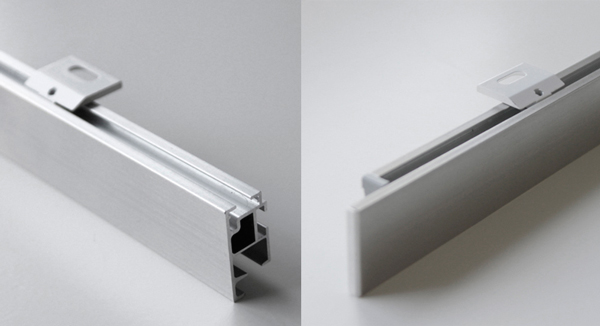 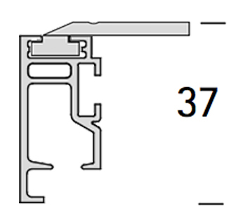
   
  <em>Interstil Sphere ceiling-mounted rails and their schematics.</em>

This lip is intended to hide the channel, and it looks really clean as a result.
However, the side-effect is that retrofit curtain automation devices, such as the [SwitchBot Curtain 3](https://eu.switch-bot.com/products/switchbot-curtain-3), don't properly work out-of-the-box.
The alternative is to buy the [motorized tracks from Interstil](https://interstil.nl/producten/smartelectric).
However, these are exorbitantly expensive, like "1000 euros per meter"-expensive 🤯.

Not willing to shell out that kind of money for curtain automation, I wanted to try to modify the SwitchBot device to make it compatible with this niche track type.

## The problem

The SwitchBot has a spring system that holds the roller against the bottom of the track so that the motor can turn the roller to move the entire device horizontally across the track.

  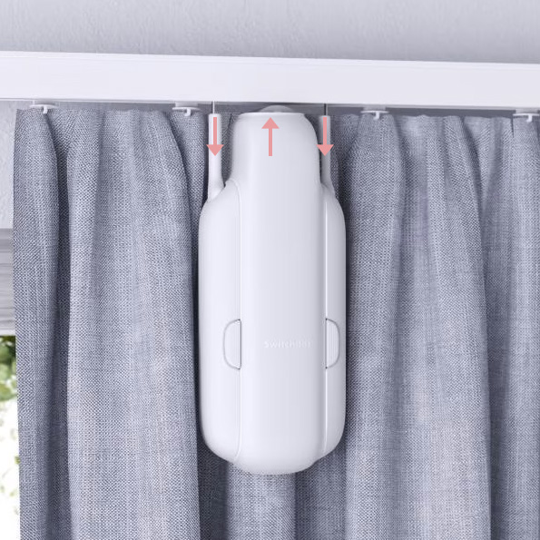
   
  <em>The center roller gets pushed against the track due to pressure from the springs in the side-handles.</em>

The problem with the track system I have is that the bottom lip is asymmetrical.
This causes the pressure from the spring system to make the device lean away from the track, scraping against the wall.

  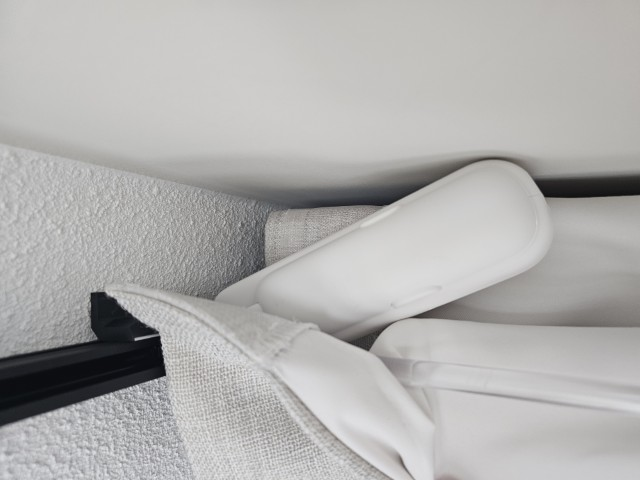
   
  <em>Problematic lean of SwitchBot device.</em>

Because the SwitchBot was not built for the large offset between the track channel and the roller, the pressure is huge and the springs are almost completely compressed.
This is what causes the lean, preventing the device from properly moving.

My thought was that using weaker springs should reduce the pressure, and decrease the lean of the device.

## The solution
The steps below are non-destructive.
You can always revert back to the original spring.

#### Step 1
Take off the handle.

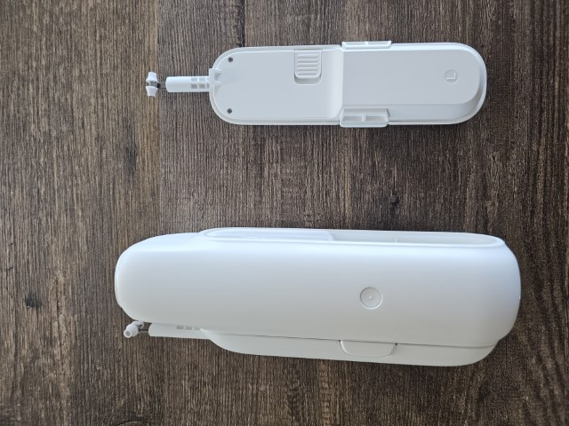

#### Step 2
Remove the detachable hook, and remove the two screws.

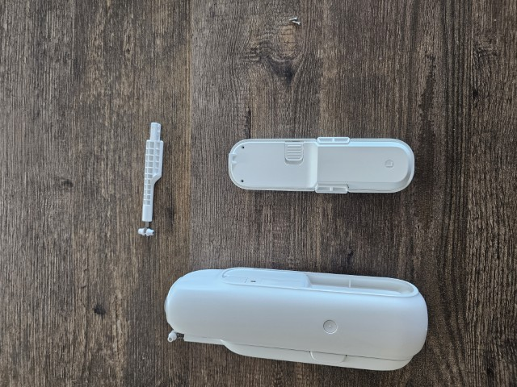

#### Step 3
Pry open the two parts.
It requires quite some force and might feel like you're gonna break it.

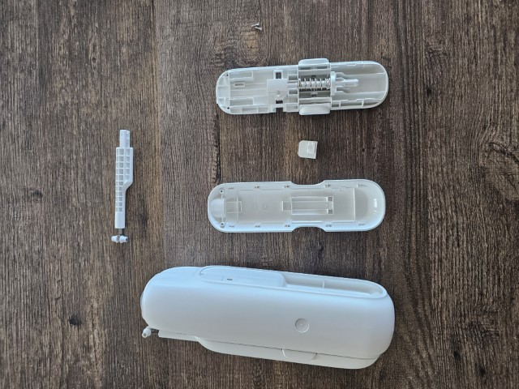

#### Step 4
Remove the spring holder from the handle.

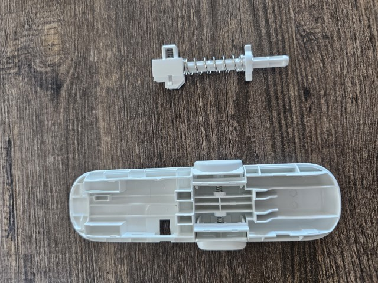

#### Step 5
Remove the spring end piece by turning it 45 degrees.

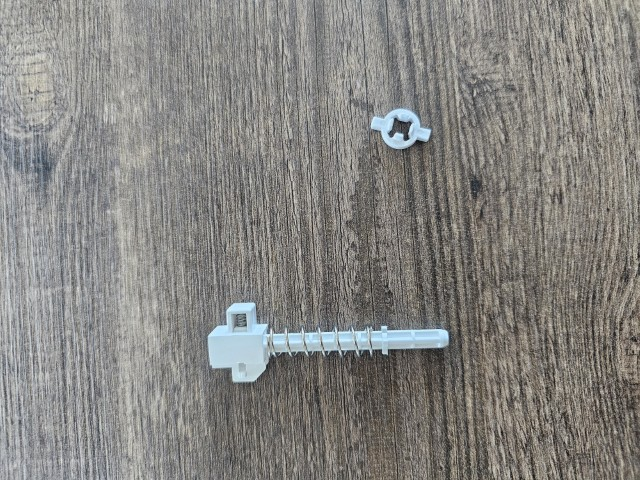

#### Step 6
Finally, remove the spring and replace it with a weaker type. Put the spring end piece back in place.
I used a 30mm x 9mm x 0.7mm spring (that's length, diameter, thickness, respectively).
On the left you see the original spring, on the right the newly installed one.

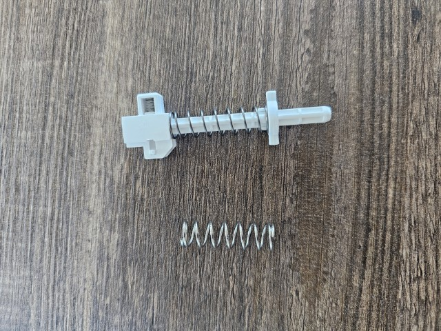

#### Step 7
Put the spring holder back in the handle.

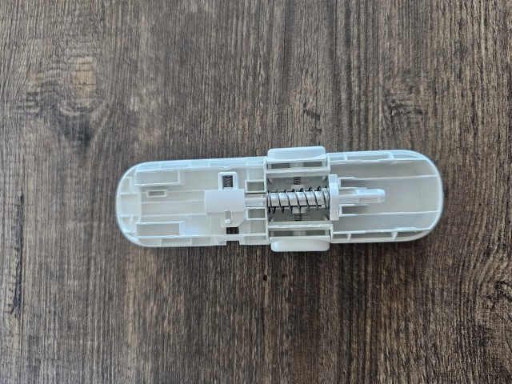

#### Step 8
Snap the two handle parts back together. Don't forget the detachable handle button that probably came loose when you pryed it open.
Put the two screws in again, as well as the detachable hook.

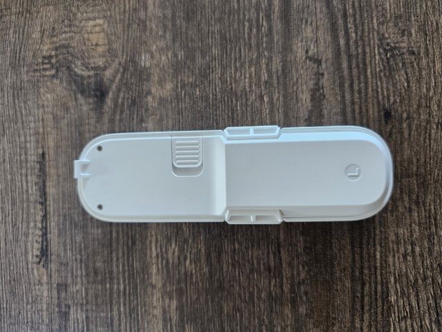

Perform all steps again for the other handle.

## Result
The device still leans, but it's much less problematic.
It doesn't scrape the wall any longer, and there's still enough pressure to properly move across the track.
Good enough for me!

  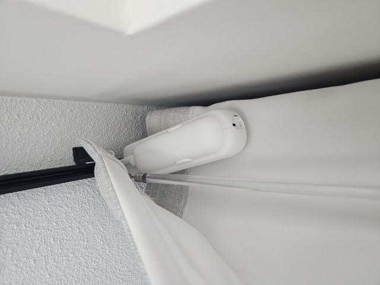
   
  <em>Success! The device now works perfectly.</em>

